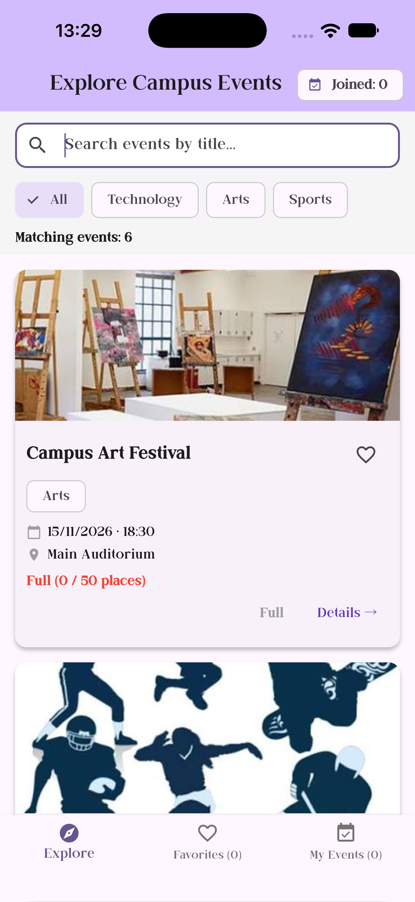
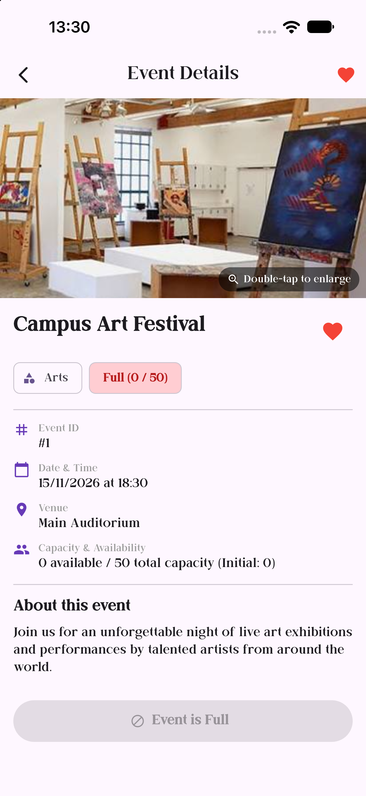
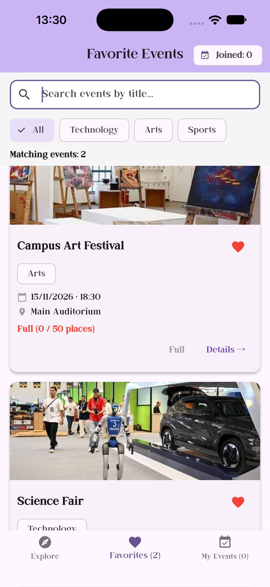
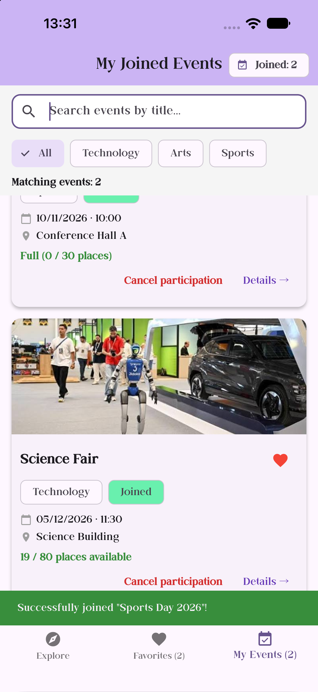

# Campus Event Explorer

**BIM493 - Mobile Programming I | Assignment #1**

## Team Members
| Full Name | Contribution |
| :--- | :--- |
| **Selin Erdoğan** | Event data model, Explore/Favorites/My Events views, Search & category filters, README documentation |
| **Ozan Yantur** | Event card widget, Event details & double-tap image viewer, Join/Cancel confirmation dialogs & capacity logic, Custom font & bundled assets |

---

## Flutter Version
Output of `flutter --version`:
```text
Flutter 3.47.6 • channel stable • https://github.com/flutter/flutter.git
Framework • revision 5fc346839b (3 weeks ago) • 2026-09-30 15:02:49 -0700
Engine • hash b8c8d3d8d5d0095127057f8a29ca8cc53da2167c (revision 692136cb65) (20 days ago) • 2026-09-30 00:56:59.000Z
Tools • Dart 3.13.5 • DevTools 2.60.0
```

---

## Setup & Run Commands
1. Clone or extract the project repository:
   ```bash
   cd campus_event_explorer
   ```
2. Fetch project dependencies:
   ```bash
   flutter pub get
   ```
3. Run the application on an emulator or connected device:
   ```bash
   flutter run
   ```

---

## Bundled Assets & Credits
* **Images (`assets/images/`):**
  * `art.jpeg` – used for `Arts` events. URL: https://www.lavinyasanatakademisi.com.tr/egitimler/resim-atolyesi.html
  * `spor.jpeg` – used for `Sports` events. URL: https://www.facebook.com/izmircup3x3/
  * `tech.jpeg` – used for `Technology` events. URL: https://www.milliyet.com.tr/teknoloji/turkiyenin-en-buyuk-teknoloji-bulusmasi-sona-erdi-7400226
* **Custom Font (`assets/fonts/`):**
  * `Galafera.ttf` (`family: galafera`) – applied globally via `ThemeData(fontFamily: 'galafera')` in `lib/main.dart`. URL: https://www.fontspace.com/category/ttf

---

## Verification Checklist
Checked with `flutter analyze` (no issues) and `flutter test` (widget tests in `test/widget_test.dart`, run on a phone-sized screen):
- [+] **Full-event case:** `Campus Art Festival` starts with `0 / 50` places and is shown as `Full`; the card's action button is disabled.
- [+] **Cancel-dialog case:** `Sports Day 2026` starts with `1 / 30`. `No` leaves data unchanged; `Yes` joins once (`0 / 30`, joined count 1); the student who took the last place can still `Cancel participation`, confirm, and the place is restored to `1 / 30`.
- [+] **Empty-search case:** a search/category combination with no match shows the empty-state message, and `Clear Search & Filters` restores all 6 events.
- [+] Search ignores letter case and surrounding spaces; empty states for Favorites and My Events; double-tap on the details image opens the enlarged viewer and Back works.

---

## Screenshots
| Explore | Event Details | Favorites | My Events |
| :---: | :---: | :---: | :---: |
|  |  |  |  |

Double-tap on the event image opens the enlarged viewer (`assets/screenshots/viewer.png`).

---

## Known Limitations
* As required by the assignment specification, favorites and event participation states are kept in memory during a single app session and reset when the application is restarted.
